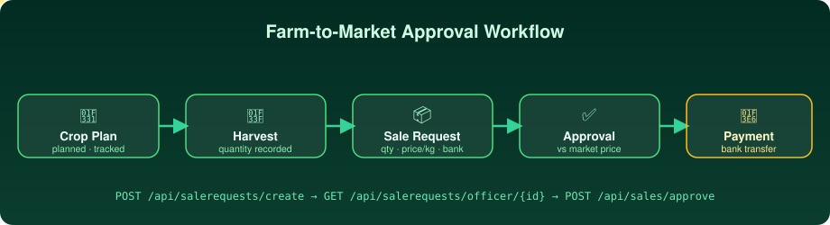
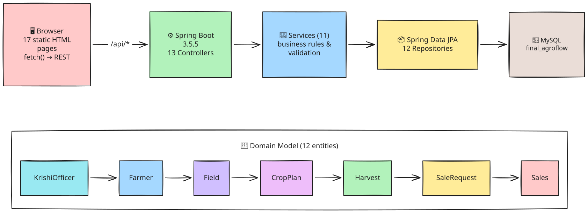
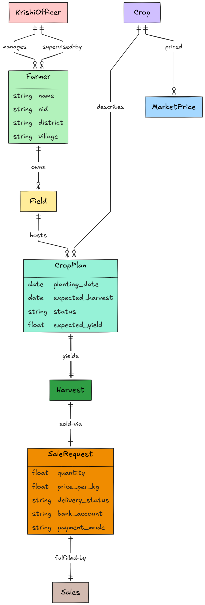
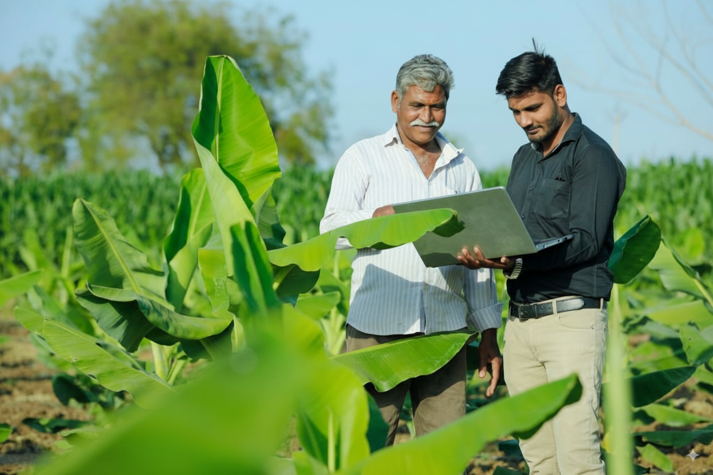
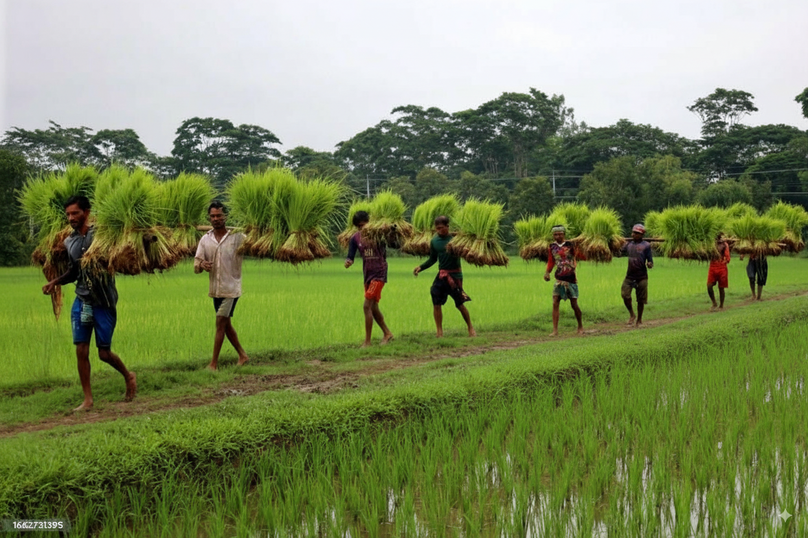
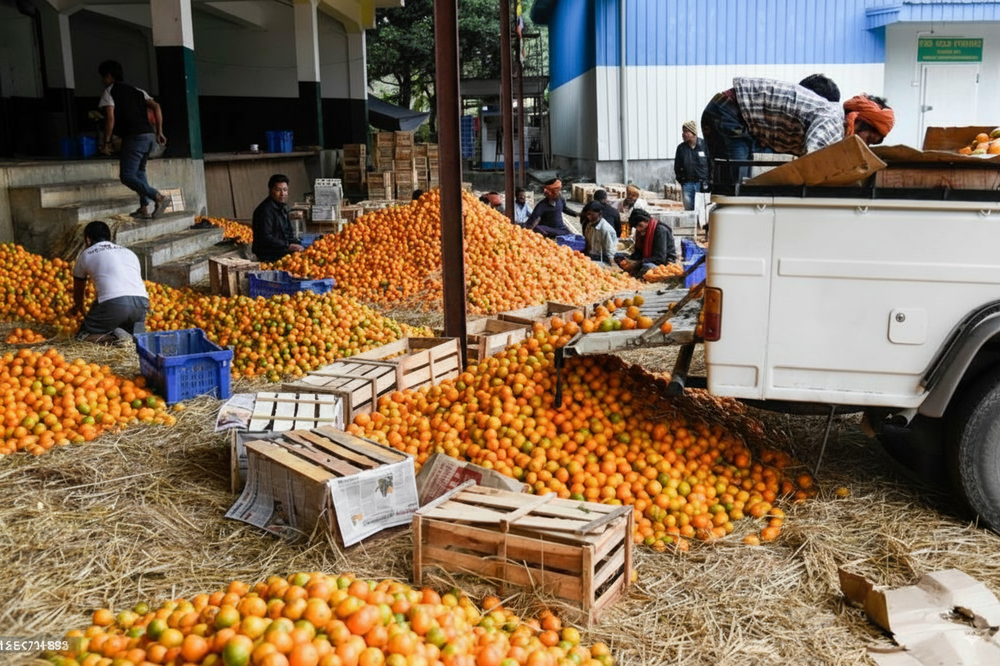

<p align="center">
  
</p>

<h1 align="center">🌾 AgroFlow</h1>

<p align="center">
  <strong>A farm-to-market management platform connecting Farmers with Krishi (Agriculture) Officers.</strong><br/>
  Plan crops → record harvests → request sales → get officer approval → receive payment.
</p>

<p align="center">
  
  
  
  
  
</p>

---

## 🧭 What is AgroFlow?

**AgroFlow** is a full-stack web application built for the agriculture ecosystem of Bangladesh, where *"Krishi"* means agriculture. It acts as a digital bridge between:

- 👨‍🌾 **Farmers** — who cultivate land, follow crop plans, and sell their harvests
- 🧑‍🏫 **Krishi Officers** — agricultural extension officers who manage farmers, monitor crops, approve sales, and analyze regional production

Officers manage the complete lifecycle: from registering farmers and planning crops on their fields, to tracking harvests, reviewing sale requests against live **market prices**, approving transactions, and viewing **analytics dashboards and reports**.

---

## 🔄 How It Works

<p align="center">
  
</p>

1. **Officer onboarding** — the Krishi Officer signs up and logs in
2. **Farmer registration** — officers register farmers (NID, district, village, contact) and add their land **fields**
3. **Crop planning** — crop plans are created per field using the crop calendar (sowing/harvest seasons, expected yield)
4. **Harvest tracking** — actual harvest quantities are recorded; plan status flips from `Ongoing` → `Harvested`
5. **Sale request** — a sale request is created against a harvest (quantity, price/kg, delivery details, bank account info); the backend validates the harvest truly belongs to the requesting farmer
6. **Approval** — the officer reviews pending requests alongside the current **MarketPrice** for the crop and approves → a `Sales` record is fulfilled (double-approval is blocked)
7. **Insight** — dashboards, analytics and reports aggregate totals, days-to-harvest, top regions and chart data

---

## 🏗️ Architecture

<p align="center">
  
</p>

---

## ✨ Features

| Area | What it does |
|------|--------------|
| 🧑‍💼 **Officer Portal** | Signup / login, profile view & update |
| 👨‍🌾 **Farmer Management** | Register, search, list by officer, profile & edit |
| 🌱 **Crop Planning** | Fields, crop catalog, crop calendar, planting → expected harvest & yield |
| 🌾 **Harvest Tracking** | Record actual yields against plans, auto status transition |
| 💰 **Sales Workflow** | Sale requests with bank details, officer approval, fulfilled-sales record |
| 📈 **Market Price** | Per-kg reference price shown during sale approval |
| 📊 **Analytics & Reports** | Dashboard cards, crop search analytics, top regions, chart data, advanced report generator |
| 🗄️ **Auto Schema** | Hibernate `ddl-auto=update` auto-creates the database schema |

---

## 📁 Project Structure

```
agroflow_noppo/
├── mvnw / mvnw.cmd                  # Maven wrapper
├── pom.xml                          # Spring Boot 3.5.5 · Java 21
├── assets/                          # Animated SVG artwork for this README
└── src/main/
    ├── java/com/noppo/agroflow_noppo/
    │   ├── controller/              # 13 REST controllers  (/api/...)
    │   ├── service/                 # 11 services (business logic)
    │   ├── repo/                    # 12 Spring Data JPA repositories
    │   ├── model/                   # 12 JPA entities
    │   ├── dto/                     # 27 DTOs (request/response shapes)
    │   └── AgroflowNoppoApplication.java
    └── resources/
        ├── application.properties   # MySQL config (dev defaults)
        └── static/                  # 17 HTML pages + UI images
            ├── index.html · login.html · signup.html
            ├── dashboard.html · register-farmer.html · farmer-profile.html
            ├── add-field.html · add-cropplan.html · record-harvest.html
            ├── request-sale.html · sale-request-details.html
            └── sales-management.html · reports.html · analytics …
```

---

## 🔌 REST API Overview

| Controller | Base Path | Key Endpoints |
|------------|-----------|---------------|
| Officer | `/api/officers` | `POST /signup` · `POST /login` · `GET /{id}` · `PUT /{id}/update` |
| Farmer | `/api/farmers` | `POST /register` · `GET /officer/{id}` · `GET /search` · `GET /{id}/profile` · `PUT /{id}/update` |
| Field | `/api/fields` | `POST /add` · `GET /farmer/{id}` |
| Crop | `/api/crops` | `GET` (crop catalog) |
| Crop Plan | `/api/cropplans` | `POST /add` |
| Harvest | `/api/harvests` | `POST /record` |
| Sale Request | `/api/salerequests` | `POST /create` · `GET /officer/{id}` · `GET /{id}/details` |
| Sales | `/api/sales` | `POST /approve` |
| Dashboard | `/api/dashboard` | `GET` (officer overview) |
| Analytics | `/api/analytics` | `GET /officer/{id}` · `GET /search-crop` |
| Reports | `/api/reports` | `GET /generate` · `POST /update` |
| Advanced Reports | `/api/advanced-reports` | `GET /summary-cards` · `/main-report` · `/top-regions` · `/chart-data` · `/filters` |

---

## 🗃️ Data Model

<p align="center">
  
</p>

> Cyclic entity relations are handled with `@JsonManagedReference` / `@JsonBackReference` for clean JSON serialization.

---

## 🖼️ UI Gallery

| | |
|---|---|
|  |  |
|  |  |

---

## 🚀 Getting Started

### Prerequisites
- ☕ **Java 21** (JDK)
- 🐬 **MySQL** running on port `3306`
- 📦 Maven (or just use the bundled wrapper `mvnw`)

### Run it

```bash
# 1. Clone the repo
git clone https://github.com/<your-username>/agroflow_noppo.git
cd agroflow_noppo

# 2. (Linux/macOS) make the wrapper executable
chmod +x mvnw

# 3. Start the app — the database `final_agroflow` is auto-created
./mvnw spring-boot:run        # Windows: .\mvnw.cmd spring-boot:run
```

Then open **http://localhost:8080** 🎉

### Configuration

Credentials are **not stored in the repository**. `src/main/resources/application.properties` reads from environment variables (`DB_URL`, `DB_USERNAME`, `DB_PASSWORD`) or an optional, gitignored `application-local.properties` file in the project root.

**Option 1 — local override file (easiest):**

```properties
# application-local.properties  (gitignored — stays on your machine)
spring.datasource.username=root
spring.datasource.password=your_password
```

**Option 2 — environment variables:**

```bash
# Windows (PowerShell)
$env:DB_USERNAME = "root"
$env:DB_PASSWORD = "your_password"
./mvnw.cmd spring-boot:run
```

The database `final_agroflow` is auto-created on first run; the schema is auto-generated via Hibernate `ddl-auto=update`.

> ⚠️ **Note:** never commit real credentials. If a secret ever lands in git history, rotate the password.

### Build a production jar

```bash
./mvnw clean package
java -jar target/agroflow_noppo-0.0.1-SNAPSHOT.jar
```

---

## 🛣️ Roadmap

- [ ] 🔐 Real authentication (Spring Security + JWT / sessions)
- [ ] 🥷 Farmer-side login so farmers can request sales themselves
- [ ] 🐳 Docker & docker-compose for one-command setup
- [ ] ☁️ Externalized configuration (env vars / profiles) & production DB
- [ ] 🧪 Unit & integration test coverage (currently minimal)
- [ ] 🔔 Notifications for pending sale requests

---

<p align="center">
  <em>🌱 From seed to sale — AgroFlow keeps the harvest flowing.</em>
</p>
